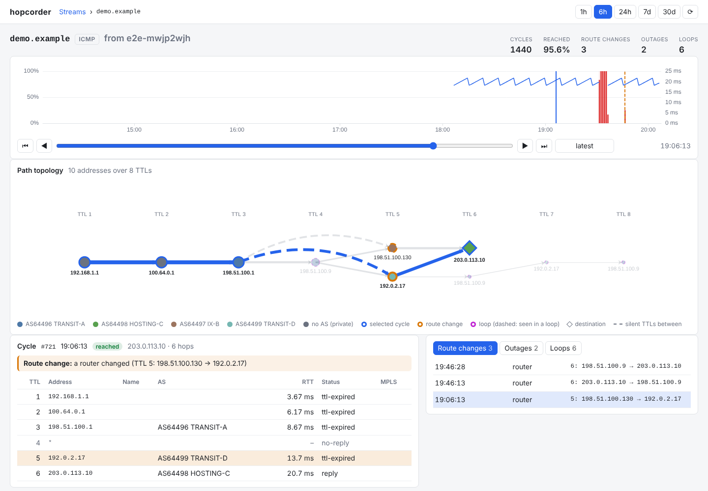

# hopcorder

A flight recorder for network paths. The agent traces the route to a set of
targets every few seconds and records every hop of every cycle, so you can
answer *when* a path broke, *at which hop*, and *whether the route changed*,
after the fact.

It exists because `mtr` cannot answer those questions: it aggregates a run into
one row per hop, and it probes each hop once per second, which trips ICMP rate
limiting on routers and shows 80–97% "loss" on hops that forward traffic fine.
hopcorder sends **one probe per TTL per cycle, all TTLs in parallel**, and
writes one record per cycle with the responding address at every TTL.

Status: milestone 4. The agent, the ingest server (ClickHouse), the Grafana
dashboards and the built-in topology UI are done. See
[`docs/HANDOFF.md`](docs/HANDOFF.md).

## Try it out

On a Linux host with Docker, from a checkout:

```bash
docker compose -f deploy/docker-compose.yml up -d --build
```

This starts ClickHouse, the server, an agent tracing three public resolvers
(ICMP, UDP and TCP; edit [`deploy/compose/agent.yaml`](deploy/compose/agent.yaml)
for your own targets), the server's own UI at <http://localhost:8080/ui/>
and Grafana with the dashboards at <http://localhost:3000>. Data shows up
within a minute. Grafana and the server listen on localhost only and answer
only requests for `localhost` (so a web page cannot reach them through DNS
rebinding), ClickHouse is not published (`docker compose -f
deploy/docker-compose.yml exec clickhouse clickhouse-client` to query it) and
Grafana reads it with a read-only user whose queries are bounded in time and
memory. Grafana's `admin` password is `HOPCORDER_GRAFANA_ADMIN_PASSWORD`
(default `admin`, set when Grafana's volume is created); the other passwords
are fixed: it is a try-out, not a deployment.
`docker compose -f deploy/docker-compose.yml down -v` removes it with its data.

## Install

Releases ([GitHub releases](https://github.com/Saremox/hopcorder/releases),
changes in [`CHANGELOG.md`](CHANGELOG.md)) have static Linux binaries for
amd64 and arm64, with the example configs and systemd units. Download the
archive, check it, then unpack it; `--no-same-owner` gives the files to
whoever unpacks them, not to the owner stored in the archive (v0.1.1's
entries belong to uid 1001, which GNU tar run as root restores):

```bash
v=0.1.1
curl -fLO "https://github.com/Saremox/hopcorder/releases/download/v$v/hopcorder_${v}_linux_amd64.tar.gz"
curl -fLO "https://github.com/Saremox/hopcorder/releases/download/v$v/SHA256SUMS"
sha256sum --ignore-missing -c SHA256SUMS
tar --no-same-owner -xzf "hopcorder_${v}_linux_amd64.tar.gz"
```

v0.1.1 has no attestations: its `SHA256SUMS` shows that the download is
intact, not who built it (anyone with write access to the repository could
have replaced both). Releases after v0.1.1 carry signed build provenance for
every file and both images, and their notes list the image digests. Check a
file or image with the [GitHub CLI](https://cli.github.com/) (2.89 checked;
one too old for a flag fails) before you use it:

```bash
v=X.Y.Z  # the release
# The commit of the tag, from the repository (exactly this ref: ls-remote
# also lists any tag whose name ends in it).
commit=$(git ls-remote https://github.com/Saremox/hopcorder "refs/tags/v$v^{}" |
  awk -v ref="refs/tags/v$v^{}" '$2 == ref {print $1}')
verify() {
  gh attestation verify "$1" --repo Saremox/hopcorder --deny-self-hosted-runners \
    --cert-identity "https://github.com/Saremox/hopcorder/.github/workflows/images.yml@refs/tags/v$v" \
    --source-ref "refs/tags/v$v" --source-digest "${commit:?no such tag}"
}
verify "hopcorder_${v}_linux_amd64.tar.gz"
digest=sha256:…  # the agent image's, from the release notes
verify "oci://ghcr.io/saremox/hopcorder-agent@$digest"
```

That proves the file or image was built by this repository's
`.github/workflows/images.yml` for the tag `vX.Y.Z`, from the commit the tag
names. Use these flags, not looser ones: gh compares `--cert-identity`
exactly, while `--signer-workflow` accepts any workflow file whose name
starts with `images.yml`, and `--source-ref` and `--source-digest` ignore
case (so a tag `VX.Y.Z` would pass), and an empty `--source-digest` checks
nothing. The release notes print the same commands with the commit filled
in, but take the commit from the tag as above: the notes are part of the
release, which someone else may have created (see [Releasing](#releasing)).
`gh release verify-asset` is no substitute: it shows that a file is part of
the release, not who built it. Anyone with write access to the repository
can still replace the images, which the attestation then no longer matches.

Or build a release; requires Linux and Go 1.27+:

```bash
go install github.com/saremox/hopcorder/cmd/hopcorder@v0.1.1
```

Name a version that has a [GitHub release](https://github.com/Saremox/hopcorder/releases),
not `@latest`: the Go module proxy serves every `v*` tag pushed to the
repository as a version, released or not, and keeps it after the tag is
gone (v0.1.0 is retracted for that reason). Or from a checkout:

```bash
make build
```

### Container images

Every push to `main` publishes multi-arch (amd64, arm64) images built from
the [`Dockerfile`](Dockerfile), static binaries on an empty base:

| Image | Runs as | Default arguments |
| --- | --- | --- |
| `ghcr.io/saremox/hopcorder-agent` | root, needs `CAP_NET_RAW` only | `--config /etc/hopcorder/agent.yaml` |
| `ghcr.io/saremox/hopcorder-server` | uid 65532 | `--listen :8080` |

Tags: releases (`v*` tags) are `<version>` (e.g. `0.1.1`), `<major>.<minor>`
and `latest`, built without caches; `main` and `sha-<commit>` follow the
`main` branch. Tags can be moved; for a fixed image use the digest from the
release notes (`ghcr.io/saremox/hopcorder-agent:X.Y.Z@sha256:…`, which
`verify oci://…` above checks like a file).

```bash
docker run -d --name hopcorder-agent --network host --cap-drop ALL --cap-add NET_RAW \
  -v "$PWD/agent.yaml:/etc/hopcorder/agent.yaml:ro" -v hopcorder-spool:/var/lib/hopcorder \
  ghcr.io/saremox/hopcorder-agent:0.1.1
```

```bash
docker run -d --name hopcorder-server -p 127.0.0.1:8080:8080 \
  ghcr.io/saremox/hopcorder-server:0.1.1 --listen :8080 --clickhouse-url http://clickhouse:8123 \
  --allowed-hosts localhost,127.0.0.1
```

The server does no authentication: publish it on localhost and put a reverse
proxy in front. `--allowed-hosts` (or `allowed_hosts`) names the hosts it
answers, against DNS rebinding: inside a container it listens on every
address, where there is no check by default. The agent runs as root because container runtimes only grant
capabilities to root; give it `NET_RAW` and nothing else. `docker build --target agent` (or
`server`) builds them locally.

### Kubernetes

Helm charts for both live in [`deploy/helm`](deploy/helm); each release
attaches the packages to the GitHub release and pushes them to
`oci://ghcr.io/saremox/charts`. Install the release's file: a release
published with immutable releases on (after v0.1.1) keeps its files, while
anyone with write access to the repository can replace a chart in ghcr.
Releases after v0.1.1 have charts that run their images by digest, and that
`verify` (above) checks like any file:

```bash
v=0.1.1
for c in hopcorder-server hopcorder-agent; do
  curl -fLO "https://github.com/Saremox/hopcorder/releases/download/v$v/$c-$v.tgz"
done
sha256sum --ignore-missing -c SHA256SUMS  # from the release, as above
```

With a ClickHouse of its own (a single pod next to the server, see below):

```bash
helm install hopcorder-server ./hopcorder-server-0.1.1.tgz \
  --set clickhouse.deploy.enabled=true
```

Or with an existing ClickHouse:

```bash
helm install hopcorder-server ./hopcorder-server-0.1.1.tgz \
  --set config.clickhouse.url=http://clickhouse.db:8123 \
  --set clickhouse.passwordSecret.name=clickhouse-password
```

```bash
helm install hopcorder-agent ./hopcorder-agent-0.1.1.tgz \
  --set server.url=http://hopcorder-server:8080 \
  --set 'config.targets[0].host=example.net' \
  --set 'config.targets[1].host=192.0.2.10' --set 'config.targets[1].protocol=tcp'
```

- **Server**: one replica (it derives route changes and outages from each
  stream's history in memory), `Recreate` on upgrade, probes on `/healthz`
  and `/readyz`, optional Ingress and ServiceMonitor. Against DNS rebinding
  (a web page reaching the UI while `kubectl port-forward` runs), it answers
  only `localhost`, `127.0.0.1`, `::1`, the Service's names and the ingress
  hosts; list other names clients use in `allowedHosts` (the chart insists
  for NodePort and LoadBalancer Services and ingress rules without host;
  `["*"]` turns the check off).
- **ClickHouse**: bring your own (an operator or a managed service, for high
  availability), or set `clickhouse.deploy.enabled=true` for a single pod
  next to the server, enough for a monitoring aid: the official
  `clickhouse/clickhouse-server` image as a one-replica StatefulSet with a
  persistent volume (`clickhouse.deploy.persistence.size`, 20Gi), no
  operator, no replication and no backups (snapshot the volume if you want
  them). The chart generates its password once (or takes
  `clickhouse.passwordSecret`), points the server at it, sizes its caches for
  about 2 GiB, keeps its own logs for 7 days, and lets only the server reach
  it (a NetworkPolicy; add Grafana with `clickhouse.deploy.networkPolicy.from`).
  `clickhouse.deploy.readOnlyUser.enabled` adds a read-only user for Grafana
  (SELECT on the hopcorder database, bounded queries), with its password in a
  generated Secret.
- **Agent**: `mode: statefulset` (default) runs `replicas` agents named
  after their pods, each with its own spool volume; `mode: daemonset` runs one
  agent per node, named after the node, with its spool on the node.
  `hostNetwork: true` traces from the node's network. The pods run as root
  with `NET_RAW`, which Pod Security `baseline` does not allow: give the
  agent a namespace of its own at the `privileged` level. Credentials for the
  ingress come from Secrets (`server.bearerTokenSecret`, `server.basicAuth`,
  `server.tls` for a CA and client certificate). Inline ones would land in a
  ConfigMap, which the built-in `view` role can read, so the charts refuse
  them: in the agent's `config`, headers such as `Authorization`, `Cookie` or
  `X-Api-Key` included (judged by name: a heuristic, so pass credentials only
  through the Secrets); in the server's, `clickhouse.password`
  (`clickhouse.passwordSecret` instead). The agent pods have no liveness
  probe: its metrics endpoint holds at most 64 connections, so a probe on it
  would let anyone who can reach the port restart the agent.
  `networkPolicy.enabled` with `networkPolicy.from` (opt-in) admits only those
  peers to the metrics port; NetworkPolicy does not apply with `hostNetwork`,
  where the nodes' firewall has to.
- **Inside the cluster** the server's Service is reachable around the
  ingress's authentication: `networkPolicy.enabled=true` with
  `networkPolicy.from` (required then) limits it to the peers you list.
  Select them by namespace (`kubernetes.io/metadata.name`; the server's
  `values.yaml` has an example), not by pod labels alone: anyone who may
  create a pod anywhere can give it any label.

Every value is documented in the charts' `values.yaml`. A chart runs the
image of its own version: a release's chart (after v0.1.1) by the digest it
was released with (`image.digest`), so moving the image's tag changes
nothing; a chart from `deploy/helm` in a checkout, by tag. `--set
image.tag=main` follows `main` instead (a tag of your own replaces the
digest; `image.tag=X.Y.Z@sha256:…` pins one). The same charts are at
`oci://ghcr.io/saremox/charts/hopcorder-server` (`--version X.Y.Z`); check
what `helm pull` downloads with `verify` before you install it. CI installs
both charts into a kind cluster, the server with its own ClickHouse, and
checks that records arrive.

### Privileges: `CAP_NET_RAW`, not root

hopcorder opens raw sockets, which needs `CAP_NET_RAW`. It never needs root.
Grant the capability to the binary once:

```bash
sudo setcap cap_net_raw+ep "$(command -v hopcorder)"
```

or run it under systemd with `AmbientCapabilities=CAP_NET_RAW` (the shipped
unit does). Without the capability the agent exits at startup and says so.

**Forged answers.** Replies to probes reach every process that asks for
them, and anyone who can send packets to the host can try to pass forged
ones off as answers. So a reply must match more than the probe's random
16-bit id: ICMPv4 errors must quote the probe's IP ID (random too), echo
replies must echo a random nonce in its data, ICMP errors that quote the
probe's payload must quote that nonce (on IPv6 they must quote it), and TCP
replies must acknowledge the SYN's exact sequence number (32 random bits).
Mismatches are dropped and counted in
`hopcorder_probe_mismatched_replies_total`. A forgery is then a guess of at
least 32 random bits: an ICMPv4 error that quotes 8 bytes needs the IP ID
and the probe id, a TCP SYN-ACK or RST the sequence number (echo replies
need 48). That is a rate, not a wall. Against a target that does not answer
(its probes stay in flight until the timeout), a spoofer sending at 1 GbE
line rate, about 1.4 million packets a second, plants a fake hop or a fake
TCP `reached` about every 2 to 3 minutes if probes are always in flight,
and about every 12 minutes at the default `timeout` (1s) and `interval`
(5s); at 10 GbE about every 1 to 2 minutes. Each forgery that lands costs
about 65,000 near misses first, all counted: alert on
`hopcorder_probe_mismatched_replies_total` (see [Metrics](#metrics) for a
rule).

The agent also holds its ICMP echo identifier (`flow_id`) with an
unprivileged "ping" socket, so no other local process can claim it. That
needs ping sockets for the agent's group (`net.ipv4.ping_group_range`,
which systemd opens to every group); where other groups have them but the
agent's does not, it logs so at startup. If another process (a second
hopcorder, a `ping`, any local user) holds the echo identifier first, the
agent's ICMP targets of that flow are not probed: it logs an error,
`hopcorder_flow_in_use` is 1 and their cycles count as errors. Every other
target is probed, and the ICMP targets resume by themselves once the
identifier is free (tried every cycle). Give every hopcorder process its
own `flow_id` (`--flow-id`).

## Quick start

Trace a few targets once and print the records:

```bash
hopcorder agent --once example.net 192.0.2.1
```

```json
{"schema":1,"agent_id":"lab-01","seq":0,"ts":"2026-11-16T22:14:05.123Z","target":"example.net","target_ip":"93.184.215.14","af":4,"protocol":"icmp","flow_id":33434,"reached":true,"path_len":9,"path_hash":"ace3702aca4b1a5a","loops":[],"hops":[{"ttl":1,"status":"ttl-expired","ip":"192.168.187.1","rtt_us":1432},{"ttl":2,"status":"no-reply"},…,{"ttl":9,"status":"reply","ip":"93.184.215.14","rtt_us":26711}]}
```

Run continuously, appending to a file:

```bash
hopcorder agent --spool-dir ./spool --jsonl ./records.jsonl example.net
```

For production use a config file and the systemd unit in
[`deploy/`](deploy/):

```bash
sudo install -m 0755 hopcorder /usr/local/bin/hopcorder
sudo install -D -m 0644 deploy/agent.example.yaml /etc/hopcorder/agent.yaml
sudo install -m 0644 deploy/hopcorder.service /etc/systemd/system/
sudo systemctl daemon-reload
sudo systemctl enable --now hopcorder
```

The unit runs as a dynamic user, which can only read world-readable files in
`/etc/hopcorder`: keep secrets (an ingest token or password, a client
certificate's key) out of the config and its directory, and pass them as
systemd credentials (`LoadCredential=`) instead, as the comments in the unit
and in `agent.example.yaml` show.

## How it works

- **One probe per TTL per cycle.** TTLs `1..max_ttl` go out together; each
  router sees one probe per interval, well under typical ICMP rate limits.
- **Paris mode (default).** Every header field that ECMP routers hash on is
  held constant across all TTLs of a cycle and across cycles, so a
  load-balanced path is traced as one consistent path instead of flapping
  between members. ICMP keeps identifier and checksum constant (the payload
  compensates for the sequence number and the nonce); UDP keeps both ports fixed and makes
  the UDP checksum the probe id; TCP keeps both ports fixed and carries the
  probe id in the SYN's sequence number. `flow_id` (ICMP id / UDP or TCP
  source port) is on every record. `paris: false` gives classic traceroute
  behaviour.
- **TCP SYN probes** reach destinations behind firewalls that drop ICMP and
  UDP. The destination's SYN-ACK or RST counts as `reply` (so does an ICMP
  port unreachable from the destination itself, i.e. a REJECT rule). The
  kernel resets the half-open connection; no connection is ever established.
- **One shared listener per address family**, replies matched to probes by
  parsing the original packet quoted inside ICMP errors. No goroutine per
  probe.
- **Spool first.** Every record is committed to an on-disk spool (bbolt)
  before any output ships it. Outputs keep their own cursors and catch up after
  outages; `kill -9` loses at most the cycle in progress.
- **No enrichment on the agent.** rDNS and ASN lookups are server-side.

### The record

One JSON record per (target, cycle). `seq` is monotonic per agent and survives
restarts; `(agent_id, seq)` is the idempotency key. A new spool (the first
start, or after the spool was deleted) begins at the current time in
microseconds, so its seqs lie above anything an earlier spool of the same
`agent_id` sent, as long as the clock is right. Per hop, `status` is
`reply` (the destination answered; for UDP, its port-unreachable),
`ttl-expired`, `unreachable` (with the ICMP `code`) or `no-reply`; `ip` and
`rtt_us` are present unless `no-reply`. Routers inside an MPLS tunnel often
report the label stack in their ICMP errors (RFC 4950); hopcorder records it
as `mpls: [{label, tc, s, ttl}, …]` on that hop.

Derived per cycle:

- **Path end**: the lowest TTL answered by the destination (or by an ICMP
  unreachable). If neither happens, `probe_past` silent TTLs are kept beyond
  the last responding hop and the rest dropped. `path_len` is the number of
  hops kept.
- **`path_hash`**: first 16 hex chars of SHA-1 over the hop IPs joined with
  `|`, `*` for silent hops: a fingerprint of the exact snapshot. A hop that
  answers in some cycles and not others alternates between two hashes, so
  don't count route changes by comparing hashes. hopcorder decides route
  changes (for `hopcorder_path_changes_total`) by remembering the last
  address at each TTL and treating silent hops as wildcards: a change is a
  TTL answering from a different address, a reached destination at a
  different distance, or a different target address.
- **`loops`**: addresses that answered *time exceeded* at more than one TTL.

`--once` records carry `seq: 0`; it does not touch the spool, so it can run
next to a running agent with another `flow_id` (`--once --flow-id 40000
example.net`). With the daemon's ICMP `flow_id` its ICMP targets fail like
any target that cannot be probed: the other targets' records are printed,
the error is logged, and the exit status is 1.

## Caveats when reading the data

- **Silence is not loss.** A router that does not answer (`no-reply`) may be
  rate-limiting or filtering ICMP while forwarding traffic fine. Real
  forwarding loss shows up at *every hop after it*, including the
  destination. Rate limiting does not propagate.
- **Loops are a floor.** A heavily rate-limited router in a loop answers only
  some cycles, so loop counts undercount.
- **One router, two addresses.** Routers may source ICMP errors from the
  interface the packet arrived on (Linux does for IPv6), so a looping router
  can appear under one address on the first pass and another on the loop
  legs. Loop detection still finds it, because the loop-leg address repeats.
- **ECMP.** In paris mode a target is pinned to one ECMP member; other flows
  (including your real traffic) may take other members. Compare with
  `paris: false` or a second `flow_id` if you suspect a single bad member.
- **Return paths are invisible.** RTTs include the reverse path, which may
  differ from the forward path that traceroute shows.
- **NAT** in front of the agent usually rewrites and restores the probe
  headers transparently; a NAT that does not restore the quoted header breaks
  reply matching (every hop beyond it shows `no-reply`).
- **IPv6 routers must quote the whole probe** in their ICMPv6 errors, as RFC
  4443 requires: one that quotes only the first 8 bytes shows `no-reply`
  (and counts in `hopcorder_probe_mismatched_replies_total`), since a spoofer
  could otherwise leave out the nonce. IPv4 routers may quote 8 bytes.
- **TCP "reply" may come from a middlebox.** Transparent proxies, SYN proxies
  and some load balancers answer the SYN with the destination's address, so a
  TCP trace can "reach" the target hops early (seen on the first test: port
  443 answered at TTL 2 behind a proxy). Compare with an ICMP or UDP trace to
  the same target when TCP distances look short.
- **Two hopcorder processes on one host** (say `--once` next to the daemon)
  need different `flow_id`s. For ICMP the second one does not probe its
  targets on that flow (the first holds the echo identifier, where ping
  sockets are permitted); with UDP or TCP, or without ping sockets, both
  probe, and the random IP IDs, nonces and sequence numbers make it very
  unlikely that one takes the other's replies.
- **Beyond the destination**: with `adaptive_max_ttl` (default), once a
  target has been reached, cycles probe only 3 TTLs past its distance. If such
  a cycle neither reaches the destination nor hits an unreachable (the path
  grew, or the destination went silent), the same cycle probes the remaining
  TTLs up to `max_ttl`, so records are identical to full-depth probing.
  Unreached targets are always probed to `max_ttl`. This also keeps the
  destination from being asked for ~20 replies per cycle, which matters for
  UDP, whose port-unreachable replies most hosts rate-limit.

## Configuration

YAML file (`--config`) plus flags; flags override the file's global values,
per-target settings in the file still win. Targets given as arguments replace
the file's targets. The whole config is validated at startup and every problem
is reported at once. See [`deploy/agent.example.yaml`](deploy/agent.example.yaml).

| Key | Default | Flag | Meaning |
| --- | --- | --- | --- |
| `agent_id` | hostname | `--agent-id` | Identifies the agent in records and metrics |
| `interval` | `5s` | `--interval` | Minimum period between cycles of a target (≥ 100ms) |
| `timeout` | `1s` | `--timeout` | Per-probe timeout; must be shorter than the interval |
| `max_ttl` | `30` | `--max-ttl` | Highest TTL probed (1–255) |
| `probe_past` | `2` | `--probe-past` | Silent TTLs kept past the last responder when unreached |
| `protocol` | `icmp` | `--protocol` | Default protocol: `icmp`, `udp` or `tcp` |
| `flow_id` | `33434` | `--flow-id` | Default ICMP identifier / UDP or TCP source port; every hopcorder process on a host needs its own |
| `paris` | `true` | `--paris` | Flow-stable probing |
| `adaptive_max_ttl` | `true` | | Probe only 3 TTLs past the destination's last distance (see below) |
| `dns_ttl` | `5m` | | Re-resolve target names this often |
| `log.level` | `info` | `--log-level` | `debug`, `info`, `warn`, `error` |
| `log.format` | `text` | `--log-format` | `text` or `json` (to stderr) |
| `spool.dir` | — | `--spool-dir` | Spool directory (required unless `--once`) |
| `spool.max_age` | `168h` | | Oldest record kept |
| `spool.max_bytes` | `1GiB` | | Stored (compressed) record bytes kept |

**Targets** (`targets:` list): `host` (name or address, required), and
overrides `protocol`, `port` (destination port: default 33434 for UDP, 443
for TCP), `af` (`4` or
`6`; names with both prefer IPv4 unless set; `--af` applies to targets given as
arguments), `flow_id`, `paris`, `adaptive_max_ttl`,
`interval`, `timeout`, `max_ttl`, `probe_past`.

**Outputs** (at least one):

- `jsonl.path` (`--jsonl`): append records to a file (or a FIFO), `-` for
  stdout. A regular file is synced to disk per batch. After a crash records
  may repeat (dedup on `(agent_id, seq)`); a torn write never runs into the
  next record. Rotate by renaming and sending SIGHUP (see Operations) or
  with `copytruncate`.
- `http`: POST zstd-compressed NDJSON to `<url>/api/v1/ingest`. Options: `url`,
  `headers`, `bearer_token` or `bearer_token_file`, `basic_auth`
  (`username`, `password` or `password_file`), `tls` (`ca_file`, `cert_file`,
  `key_file`, `server_name`), `timeout` (30s), `batch_max_records` (500),
  `batch_max_bytes` (1MiB), `flush_interval` (10s), `retry_min` (1s),
  `retry_max` (1m). Secret files are re-read per request. Any non-2xx is
  retried with jittered exponential backoff; records stay in the spool until
  accepted. hopcorder does no user authentication itself: secure the server
  behind your reverse proxy (basic auth, OIDC, mTLS).
- `metrics.listen` (`--metrics-listen`), `metrics.path` (`/metrics`):
  Prometheus endpoint, served at exactly that path (`/` and then
  `[A-Za-z0-9/._~-]`, at most 256 characters; any other path answers 404).

### Metrics

All carry the constant label `agent_id`; labels are only ever configured
values (`target` = the configured host, `protocol`, `result`, `output`), never
hop addresses.

| Metric | Labels | |
| --- | --- | --- |
| `hopcorder_cycles_total` | target, protocol, result=`reached`\|`unreached` | Completed cycles |
| `hopcorder_e2e_rtt_seconds` | target, protocol | Histogram of destination RTT |
| `hopcorder_path_length` | target, protocol | Hops in the last cycle |
| `hopcorder_path_changes_total` | target, protocol | Route changes (silent hops match anything; see above) |
| `hopcorder_loops_detected_total` | target, protocol | Cycles with at least one loop |
| `hopcorder_cycle_overruns_total` | target, protocol | Cycles longer than the interval |
| `hopcorder_cycle_errors_total` | target, protocol | Cycles that could not run |
| `hopcorder_flow_in_use` | target, protocol | Targets not probed because another process holds their ICMP echo identifier (`flow_id`): 1 while a single target is |
| `hopcorder_resolve_errors_total` | target, protocol | Failed DNS lookups |
| `hopcorder_output_errors_total` | output | Failed deliveries |
| `hopcorder_output_pending_records` | output | Spooled, not yet delivered |
| `hopcorder_output_abandoned_total` | output | Deliveries still blocked when a configuration stopped (reload or shutdown), left behind; their records stay spooled |
| `hopcorder_spool_bytes`, `hopcorder_spool_records` | | Spool contents |
| `hopcorder_spool_records_dropped_total` | | Undelivered records dropped by the bounds |
| `hopcorder_probe_late_replies_total` | | Replies after the timeout |
| `hopcorder_probe_mismatched_replies_total` | | Replies matching an in-flight probe's id but not its IPv4 ID, nonce or TCP sequence number, dropped: answers to another process's packets, forgeries, or a middlebox rewrites IP IDs (hops beyond it then stay silent) |
| `hopcorder_probes_sent_total`, `hopcorder_probe_send_errors_total` | | Probe packets |
| `hopcorder_build_info` | version, goversion | |

Two targets with the same `host` and `protocol` (another `port` or `af`)
share their per-target series, as the labels are only configured values:
counters count both, the RTT histogram mixes them, `hopcorder_path_length`
is the last cycle's, and `hopcorder_flow_in_use` counts those not probed.
The agent warns at start. To tell them apart, give one an address or
another name of the host.

Forged replies (see [Privileges](#privileges-cap_net_raw-not-root)) show
as mismatched replies long before one gets through: each takes about
65,000 tries that match a probe's id but not the rest. This rule fires once
600 have come within 10 minutes. A slow spoofer then has about a 1% chance
of having planted one hop; one at line rate is caught within a scrape or
two, about when its first one lands. Without an attack the counter grows
only for the other reasons above (a middlebox that rewrites IP IDs, an IPv6
router that quotes too little, another prober on the same `flow_id`), each
of which silences hops and is worth knowing; where one is known and steady,
set the threshold above its rate.

```yaml
groups:
  - name: hopcorder
    rules:
      - alert: HopcorderMismatchedReplies
        expr: increase(hopcorder_probe_mismatched_replies_total[10m]) > 600
        annotations:
          summary: >-
            {{ $labels.agent_id }} drops replies that match a probe's id but
            not the rest of it: forged replies, a second prober on the same
            flow_id, or a middlebox that rewrites IP IDs (hops beyond it
            then stay silent)
```

## Operations

- **Shutdown** (SIGINT/SIGTERM): probing stops at once (in-flight cycles are
  abandoned) and the metrics endpoint answers 503, outputs get up to 3
  seconds to ship what is spooled, and the rest stays in the spool for the
  next start. A delivery that blocks (a JSONL file on a hung mount, a
  blocking stdout nobody reads) is given 3 more seconds and then left
  behind, counted in `hopcorder_output_abandoned_total`; writes to a FIFO or
  pipe give up at once. A reload stops the running configuration the same
  way.
- **Reload** (SIGHUP, `systemctl reload hopcorder`): the config file is read
  again with the same command-line flags applied on top. If it is invalid, the
  error is logged and the running configuration stays. Otherwise the agent
  restarts in-process with it (raw sockets stay open, seq continues, and so
  does the metrics listener while its address is unchanged; a new address is
  bound before the old one is released, and the ICMP echo identifiers of
  both configurations are held until the new one runs). If the new
  configuration cannot start, for example because its new metrics address
  is taken, the previous one is started again; if that fails too, it is retried (from 1 s, doubling
  to a minute) until it starts or another reload brings one that does, with
  errors in the log and the metrics endpoint answering 503 meanwhile. A
  reload never stops the agent. Moving the endpoint to another address with
  the same port (`127.0.0.1:9469` to `:9469`) needs a restart: the new
  address cannot be bound while the old one is. Every reload reopens the JSONL
  file, so log rotation can rename it and send SIGHUP instead of using
  `copytruncate`:

  ```
  /var/log/hopcorder/records.jsonl {
      daily
      rotate 14
      compress
      delaycompress
      postrotate
          systemctl reload hopcorder
      endscript
  }
  ```
- **No route to a target** (uplink down) is recorded as a cycle in which
  nothing answered, so outages are visible as data rather than gaps.
- **DNS**: names are re-resolved in the background every `dns_ttl`; if that
  fails the last address keeps being used. Address changes are logged and every
  record carries `target_ip`.
- **Spool disk use** tracks the high-water mark of `max_bytes` plus database
  overhead; the file reuses free space but does not shrink.
- **A corrupt spool file** (its page structure or consistency check fails at
  start, or bbolt faults or panics on it while the agent runs) is renamed to
  `spool.db.corrupt-<time>` and an empty spool starts, its seqs taken from
  the clock like any new spool's; the error is logged. The records
  in the old file are not delivered.
- **The HTTP output never follows redirects**: point `url` at the server
  itself. A 3xx is logged as an error and the batch retried. With a plain
  `http://` URL the agent warns at startup if credentials or headers are
  configured, and refuses `tls` settings.

## Server

`hopcorder server` receives the agents' batches and stores them in
ClickHouse. It needs no privileges and no ClickHouse client library: it talks
to ClickHouse's HTTP interface, creates the database and applies migrations on
startup, and retries until ClickHouse is reachable (`/readyz` and ingest
answer 503 meanwhile; agents keep spooling).

```bash
hopcorder server --clickhouse-url http://127.0.0.1:8123
```

Point agents at it with `outputs.http.url`. For production use
[`deploy/server.example.yaml`](deploy/server.example.yaml) and
[`deploy/hopcorder-server.service`](deploy/hopcorder-server.service).
hopcorder does **no authentication**: it listens on localhost by default; put a
reverse proxy in front and secure the path prefixes separately.

**Only the proxy.** Every local user can reach `127.0.0.1:8080` around the
proxy, and so read everything and send records. To admit only the proxy,
listen on a unix socket: under systemd, install
[`deploy/hopcorder-server.socket`](deploy/hopcorder-server.socket) too and set
`listen: systemd`. systemd then creates `/run/hopcorder-server.sock` with
mode 0660 for the group in `SocketGroup=` (the proxy's; the shipped
`hopcorder-proxy` does not exist, so the socket does not start until you set
it) and hands it to the server:

```bash
sudo install -m 0644 deploy/hopcorder-server.socket /etc/systemd/system/
sudo systemctl daemon-reload
sudo systemctl edit hopcorder-server.socket   # [Socket] SocketGroup=caddy (your proxy's group)
# /etc/hopcorder/server.yaml: listen: systemd
sudo systemctl enable --now hopcorder-server.socket && sudo systemctl restart hopcorder-server
curl --unix-socket /run/hopcorder-server.sock http://localhost/healthz
```

Point the proxy at it (Caddy `reverse_proxy unix//run/hopcorder-server.sock`,
nginx `proxy_pass http://unix:/run/hopcorder-server.sock;`). Health and metrics
are on the socket too; Prometheus scrapes through the proxy. Without systemd,
`listen: unix:/path/to.sock` creates the socket itself, with mode 0660 for its
owner and group. On a unix socket the server checks no `Host` header unless
`allowed_hosts` lists names: list the proxy's public names if it admits
clients by address rather than by credentials.

**Host names.** So that a web page cannot reach a server on localhost or an
internal address through DNS rebinding (its own name resolving to the
server's address), the server answers only requests whose `Host` header is in
`allowed_hosts` (any port), others get 421. Without the option, a server on a
loopback address answers `localhost`, `127.0.0.1`, `::1` and its listen host;
on any other address it checks nothing, since it is reached under service
names, pod IPs and ingress hosts it cannot know: list them to get the check
(the Helm chart lists its own). `*.example.net` allows the names one label
below `example.net`, as an Ingress host of that form routes them.
A reverse proxy on the same host that passes the client's `Host` on (Caddy,
Traefik; nginx sends the upstream's by default) needs its public names in
the list. `"*"` turns the check off; `/healthz`, `/readyz` and `/metrics`
answer every host.

| Path | For | |
| --- | --- | --- |
| `POST /api/v1/ingest` | agents | zstd/gzip/plain NDJSON of wire records |
| `GET /api/v1/query/targets` | readers | streams seen, with last state and reach ratio |
| `GET /api/v1/query/cycles` | readers | full cycles with enriched hops (`agent`, `target` required) |
| `GET /api/v1/query/path-changes` | readers | route changes with the TTLs and addresses that changed |
| `GET /api/v1/query/loops` | readers | looping addresses per cycle |
| `GET /api/v1/query/outages` | readers | reachability-loss windows (open ones have `end_ts: null`) |
| `GET /api/v1/query/topology` | readers | one stream aggregated for the hop graph: `nodes`, `edges`, `timeline` (`agent`, `target` required) |
| `GET /ui/` | readers | the web UI (`ui: false` turns it off) |
| `GET /healthz`, `/readyz`, `/metrics` | operators | liveness, readiness (schema applied, ClickHouse up), Prometheus |

Query parameters: `agent`, `target`, `protocol`, `from`, `to` (RFC 3339 or Unix
ms; default the last 24h), `limit` (default 1000, max 10000; for `cycles`
max 1000). Results are newest first; `cycles` also takes `order=asc`. `topology` returns every
address that answered at each TTL (`nodes`), every pair of consecutive
answering hops within a cycle (`edges`, which skip silent TTLs), and
reachability per time bucket (`timeline`, at most 400 buckets); nodes and
edges are capped. Every response is bounded by `query.max_response_bytes`
(32 MiB, streamed as the rows arrive): rows beyond it are left out, and
`truncated: true` says so (`false` otherwise); `topology` fills its
`timeline` first.

**Ingest semantics.** Records are deduplicated on `(agent_id, seq)`: a retried
batch is stored once. Invalid records are rejected for good and reported in the
response (`{"accepted", "duplicates", "rejected", "errors"}`); a storage
failure returns 503 and the agent retries. Agents must never reuse seqs: a new
spool starts its seqs at the clock (time in microseconds), above anything an
earlier spool of the same agent sent; only on a host whose clock is wrong does
a wiped spool also need a new `agent_id`. A batch whose seqs all lie
far below the stored ones is refused with 409, so the agent keeps it and its
errors show what happened.

**Limits.** Ingest takes `Content-Type: application/x-ndjson` (agents send it;
the content types a web page can send without a CORS preflight are refused),
bodies up to `ingest.max_body_bytes` (8 MiB) and `max_decoded_bytes` (32 MiB),
at most 16 agents and 4096 streams per request, and `ingest.max_concurrent`
requests at once. A body is read in full (within 20 s, at most 64 at once,
each first reserving its size in a buffer of 32 MiB or twice
`max_body_bytes`, whichever is larger) before its request waits for one of
the `max_concurrent` slots, so slow clients hold none. Records are validated against the schema's limits: `agent_id` from
`[A-Za-z0-9._:-]` (at most 128 characters), targets from `[A-Za-z0-9._:%-]`
(255; an IPv6 zone at most 15 characters from `[A-Za-z0-9._-]`), protocol
`icmp`, `udp` or `tcp`, at most 255 hops and 16 MPLS labels per hop, hop and
loop addresses of the record's address family and without a zone, and `ts`
at most `ingest.max_record_age` (30 days) old and at most a day ahead of the
server's clock. Errors reported for rejected records are at most 200 bytes and
never quote the record. The server keeps state for at most
`ingest.max_streams` streams (20,000; 1 to 9 KiB each), at most
`ingest.max_streams_per_agent` of one agent (4096, or half of `max_streams` if
less), and `ingest.max_agents` agents (10,000). It drops idle ones after
`stream_idle_timeout`; at `max_streams` the agents with the most streams drop
their least recently used, beyond `max_agents` the least recently used agents
go. Dropped ones are restored from ClickHouse when they return, at most 256
per request within 5 s (the rest with their next batch); the cycles of a
stream without state derive no events and are counted in
`hopcorder_server_unrestored_cycles_total`. Running in a cgroup
with a memory limit (a container, or a systemd unit with `MemoryMax=`), the
server sets the Go memory limit to 90% of it unless `GOMEMLIMIT` is set.
Read-API queries are limited to `query.max_concurrent` at once and to
`query.max_memory_bytes` (1 GiB) each in ClickHouse, run read-only, and are
stopped there after `max_execution_time` (the ClickHouse timeout less 5 s)
or when the client goes away; a response streams for as long as its client
keeps reading.

**Enrichment.** Every hop gets its origin AS (`hop_asn`, `hop_as_name`) from
the [iptoasn](https://iptoasn.com) database, downloaded daily and cached on
disk (or a file you maintain), and its reverse DNS name, resolved in the
background so ingest never waits on DNS.

**Tables** (database `hopcorder`): `cycles` (one row per cycle, hops as Nested
columns), `hops` (one row per hop per cycle, the table to query for latency
and loss), `loop_events`, `path_changes` and `outages` (both
`ReplacingMergeTree`: query them with `FINAL`), `agent_seq`. The view
`path_probes` presents `hops` under the prototype's column names, so the
queries in [`docs/prototype/schema.sql`](docs/prototype/schema.sql) run as they
are (database `hopcorder` instead of `netpath`), except Q3, which needs a fix
on current ClickHouse ([`docs/HANDOFF.md`](docs/HANDOFF.md) §10). Data expires after
`clickhouse.retention_days` (default 90). Route changes use
the same rule as the agent's metric: silent hops match anything, so a
rate-limited router flickering does not count.

## Web UI

The server serves a UI at `/ui/` (behind the same reverse proxy as the read
API; it works under any path prefix). Pick a stream, then:

- **The timeline** shows the share of cycles that missed the destination and
  its RTT, outage windows and route changes. Click or drag on it to select a
  moment, or step with the buttons (← → cycle by cycle, Shift+← → route
  change by route change).
- **The path topology** draws every address that answered, one column per
  TTL, coloured by origin AS, with edges as wide as the share of cycles that
  took them (dashed where silent TTLs lie between). The selected cycle's path
  is highlighted; at a route change the old and new hops are ringed, and
  loops are drawn in magenta. Scroll to zoom, drag to pan, click an address
  for details.
- **The cycle** hop by hop (address, name, AS, RTT, status, MPLS labels), and
  the range's route changes, outages and loops, each a click away.

The URL holds the whole view, so links can be shared.



## Dashboards

[`dashboards/hopcorder.json`](dashboards/hopcorder.json) is a Grafana
dashboard for the [ClickHouse data
source](https://grafana.com/grafana/plugins/grafana-clickhouse-datasource/),
built from the prototype's analysis queries. Pick an agent, a target and a
protocol, and a second target to compare with:

- **When does it break?** Unreachable cycles per target, the outage windows,
  and two targets side by side (failing in the same minutes points at a shared
  transit).
- **Where does it break?** For failed cycles, the last hop that still answered
  (with its AS); per-hop no-reply rate and RTT as heatmaps; end-to-end RTT;
  and the *real loss vs rate limiting* table, which flags a hop's loss as real
  only if the end-to-end loss is comparable.
- **Did the route change?** Route changes with the hops that changed and the
  full path before and after (also as annotations on every time series), loops,
  and path length.

To use it with your own Grafana, install the plugin, provision the data
source and dashboard from [`deploy/grafana/provisioning`](deploy/grafana/provisioning)
(it reads `HOPCORDER_CLICKHOUSE_HOST`, `_PORT`, `_DATABASE`, `_USER` and
`_PASSWORD` from Grafana's environment), or import the JSON and pick your
ClickHouse data source. Give Grafana a read-only ClickHouse user with bounded
queries, as [`deploy/compose/clickhouse-init.sql`](deploy/compose/clickhouse-init.sql)
does: anyone who can open a dashboard can send Grafana SQL, with any
settings the user allows. Use `readonly = 1`, which allows none but those
marked `CHANGEABLE_IN_READONLY` (the plugin sends `max_execution_time`):
with `readonly = 2` one query could switch off ClickHouse's memory tracking
and crash it, fill its disk with temporary data or its own logs, or pin
memory in the query cache. Set Grafana's `server.domain` and `enforce_domain`
when it runs on localhost, as the compose stack does, against DNS rebinding.

## Development

```bash
go build ./cmd/hopcorder
go test -race ./...
go vet ./...
golangci-lint run
```

Nothing in `go test ./...` needs root, `CAP_NET_RAW` or network access:
everything above `internal/probe` runs against a scripted fake prober, and the
probe engine itself is tested against an in-memory network that answers with
real ICMP bytes. Raw-socket tests live behind the `rawsock` build tag and skip
without privileges:

```bash
go test -c -tags rawsock -o probe.test ./internal/probe
sudo setcap cap_net_raw+ep probe.test
./probe.test -test.v
```

Run as root (or with `CAP_SYS_ADMIN`) and with iproute2 installed, they also
build a four-namespace routed topology to check real TTL expiry and a real
routing loop.

Server tests against a real ClickHouse live behind the `clickhouse` build tag.
Give the test ClickHouse a password even on localhost: any web page open in
your browser can send SQL to `127.0.0.1:8123`, and ClickHouse lets it read the
answer.

```bash
export HOPCORDER_CLICKHOUSE_PASSWORD=$(openssl rand -hex 16)
docker run -d --name hopcorder-clickhouse -p 127.0.0.1:8123:8123 \
  -e CLICKHOUSE_PASSWORD="$HOPCORDER_CLICKHOUSE_PASSWORD" clickhouse/clickhouse-server:25.8
```

```bash
make clickhouse   # HOPCORDER_CLICKHOUSE_URL=http://127.0.0.1:8123, _USER=default, _PASSWORD from the environment
```

They include every dashboard query, expanded the way Grafana and the plugin
would. The `grafana` tag runs them through Grafana itself, against the compose
stack (`make up`, then `make grafana`).

The UI lives in [`ui/`](ui/) (Vue 3, TypeScript, Vite, ECharts; Node.js 22).
Its build in `internal/ui/dist` is committed, so building hopcorder needs no
Node.js; rebuild and commit it with every UI change (`make ui`, which CI
checks):

```bash
cd ui && npm ci
npm run dev        # http://localhost:5173, API proxied to a server on :8080
npm test           # unit tests
npm run build      # type check, then write internal/ui/dist
```

Browser tests (Playwright) run against a server with ClickHouse and
`ui/e2e/asn.tsv` as its ASN database (see the `ui` job in CI):

```bash
HOPCORDER_URL=http://127.0.0.1:8080/ make e2e
```

### Releasing

Add a `## vX.Y.Z` section to [`CHANGELOG.md`](CHANGELOG.md) (it becomes the
release notes), merge it, then tag `main` and push the tag:

```bash
git tag -a vX.Y.Z -m "hopcorder vX.Y.Z" && git push origin vX.Y.Z
```

The `images` workflow first checks the tag
([`scripts/release-verify.sh`](scripts/release-verify.sh)): `v<semver>` on a
commit of `main` whose `ci` run succeeded (it waits for one still running),
above the latest release, and not released before. It then builds, all
without caches, the images (pushed only as `:sha-<commit>`, by a job that
may write packages and nothing else) and, in a job without write tokens, the
Linux binaries, chart packages (which run those images by digest) and
checksums. The `attest` job, the only one that can sign and which runs
nothing else, attests every release file and both image digests (signed
build provenance). The `publish` job, in the `release` environment (where
required reviewers approve it), checks again, tags the images `:X.Y.Z`,
`:X.Y` and `:latest` (a pre-release such as `vX.Y.Z-rc.1` only
`:X.Y.Z-rc.1`), pushes the charts with version X.Y.Z and creates the GitHub
release, whose notes get the image digests and the `gh attestation verify`
commands ([`scripts/release-notes.sh`](scripts/release-notes.sh)). It
creates the release as a draft and publishes it only if the draft is the
only release of the tag, has exactly the files the run built (by name and
SHA-256: none missing, none changed, none added) and its notes, and the tag
still names the commit it built, through any number of annotated tags (so
promoting with `git tag -a v1.0.0 v1.0.0-rc.1` is fine); then it checks all
that again, and deletes the release if GitHub confirms a difference
([`scripts/release-publish.sh`](scripts/release-publish.sh)). A version is
released once; to fix a release, release the next version. Pull requests
run all of it but the attestations and the publishing.

What the `release` environment does not do: it gates this workflow's
`publish` job, not the repository's packages and releases. Anyone with write
access can push a workflow of their own that asks for `packages: write` and
`contents: write` and leaves the environment out, and replace the images
and charts of any version, and the files of a release that is not
immutable. They can also create a release of a tag that has none yet, and
change a draft: immutable releases protect a release only once it is
published. GitHub's attestation of a release (`gh release verify` and
`verify-asset`) then vouches for their files as well, since it shows that a
file is part of the release, not who built it. The build provenance shows it
(a file or digest that `images.yml` did not build for the tag's commit
fails the `verify` above), and `publish` fails loudly: `a release of vX.Y.Z
exists already` or `someone else created a release`/`changed the draft`
means that release is someone else's. Look at it, point no one at it, and
release the next version. The repository settings limit all this: a tag
ruleset that only the maintainers may bypass (not GitHub Actions),
immutable releases, and required reviewers on `release`. Give write access
only to people you would let release.

## License

MIT
